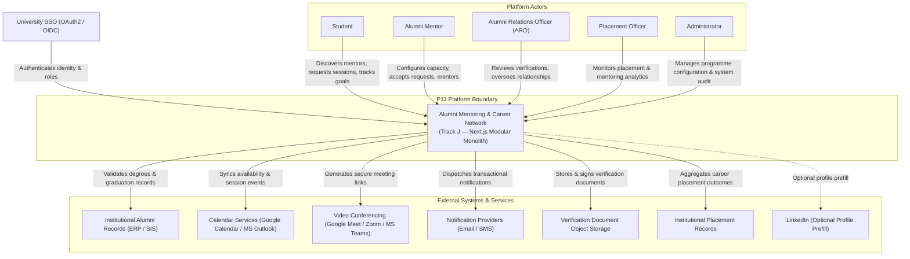
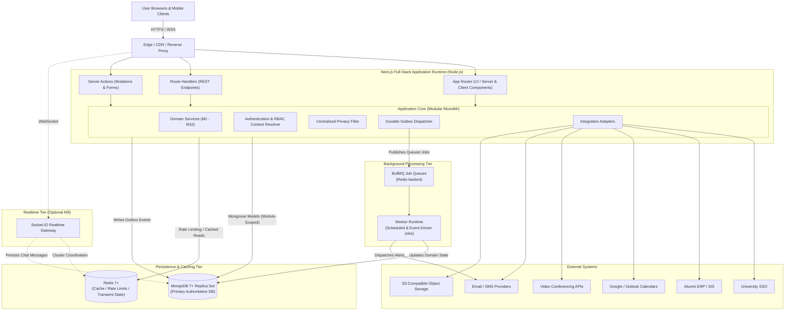
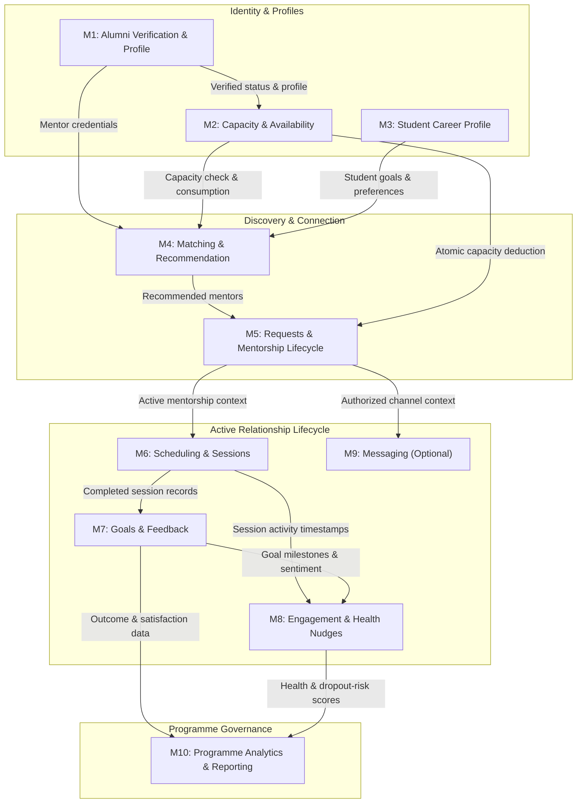
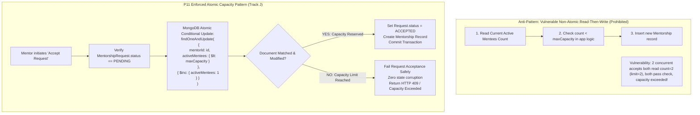
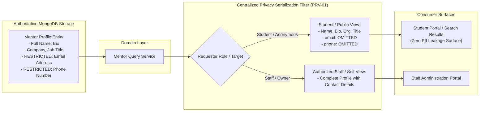
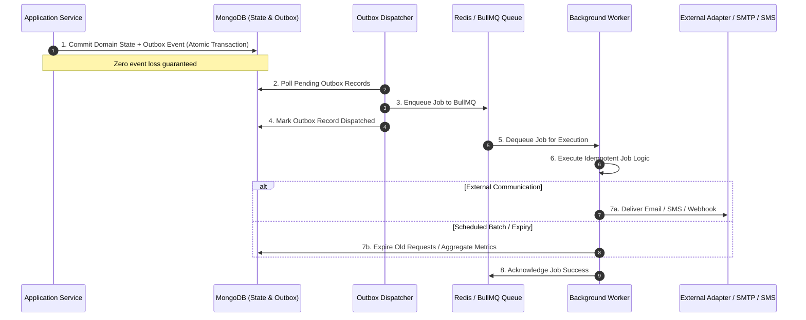
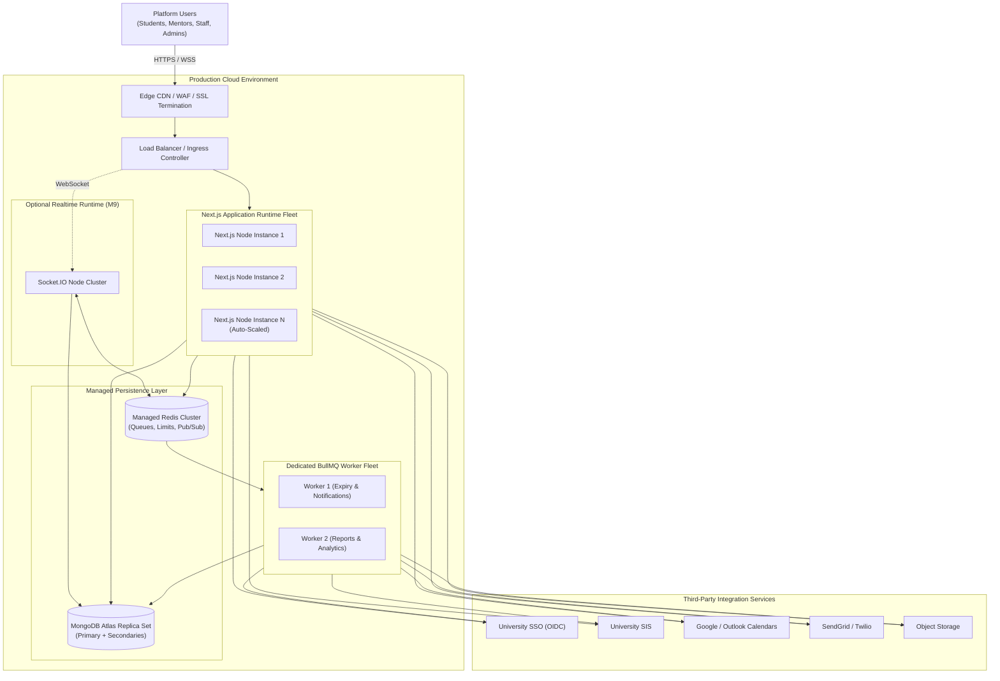

# Architecture Visualizations Guide
## Project 11 — Alumni Mentorship and Career Network

This document provides a visual-first walkthrough of the core architectural patterns, components, flows, and security boundaries of the P11 Platform (Track J — Next.js Full-Stack Modular Monolith).

All diagrams are rendered in interactive **Mermaid.js** format.

---

## 1. System Context Architecture
Shows the platform boundary, primary human actors, and all external institutional integrations.

---

## 2. Container-Level Runtime Architecture
Displays the Next.js App Router boundary, Application Core, MongoDB primary store, Redis caching/throttling, BullMQ async processing, and optional Socket.IO realtime server.

---

## 3. Module Dependency & Boundary Architecture
Illustrates the 10 distinct domain modules (M1–M10) and enforces that all communication occurs strictly through public domain service interfaces rather than cross-module direct database querying.

---

## 4. Mentor Capacity & Concurrency Architecture (INV-02)
Visualizes how the critical invariant `Active mentees <= Mentor capacity` is strictly preserved under high-concurrency race conditions using MongoDB atomic conditional updates (`$inc` with `$lt` condition).

---

## 5. Privacy & Data Protection Architecture (INV-06 / PRV-01)
Demonstrates how alumni mentor contact information (email, phone) is shielded at the centralized output serialization layer, ensuring student-facing responses never leak private PII.

---

## 6. Asynchronous Outbox & Background Processing Architecture
Shows how committed database mutations write durable outbox events within the same transaction to guarantee reliable delivery to BullMQ and asynchronous workers with zero event loss.

---

## 7. Production Deployment & Cloud Topology
Defines the multi-instance Next.js deployment, background worker cluster, Redis cluster, MongoDB Atlas replica set, and edge CDN layer.

---

## Summary of Architectural Baselines

| Key Area | Selected Approach | Key Correctness Guarantee |
|---|---|---|
| **Framework** | Next.js 15+ (App Router, Route Handlers, Server Actions) | Track J / Path J1 Full-Stack standard |
| **Monolith Architecture** | Modular Monolith (M1–M10) | Module-scoped Mongoose models, strictly interface-mediated cross-module calls |
| **Primary Database** | MongoDB 7+ Replica Set | Durable ACID transactions for cross-entity consistency |
| **Async Processing** | Redis 7+ and BullMQ | Transactional Outbox pattern guarantees zero event loss |
| **Capacity Concurrency** | Atomic conditional updates (`$inc` with `$lt`) | Strict preservation of `Active mentees <= Mentor capacity` (`INV-02`) |
| **Data Privacy** | Centralized server-side serialization filter | PII isolation (email/phone never leaked to students, `PRV-01`) |
| **Security & Auth** | University SSO (OIDC) + TOTP MFA + ABAC | Defense-in-depth security model |
| **Scale Target** | 2,000 sustained / 5,000 peak concurrent users | Low latency (read p95 < 400ms, write p95 < 800ms) with isolated workers |
