# System Architecture / High-Level Design (HLD)

## Project 11 --- Alumni Mentorship and Career Network

| Field | Value |
| --- | --- |
| Product | Verified Alumni Mentorship Matching and Engagement Platform |
| Project ID | P11 |
| Document | System Architecture / High-Level Design (HLD) |
| Version | 1.0 |
| Status | Foundation Draft |
| Architecture Track | Track J — Path J1 (Next.js Full-Stack) |
| Primary Product Baseline | P11 PRD v1.0 |
| Primary System Baseline | P11 SRS v1.0 |
| P11 Source Baseline | `docs/P11_Project_Source.md` |
| Engineering Standard | EduRev Common Engineering Standard (CES) |

------------------------------------------------------------------------

## Table of Contents

| No. | Section | Purpose |
| ---: | --- | --- |
| 1 | [Architecture Purpose](#1-architecture-purpose) | Defines the role and goals of the architecture. |
| 2 | [Architecture Drivers](#2-architecture-drivers) | Identifies the requirements that most strongly influence architecture. |
| 3 | [Architecture Decisions](#3-architecture-decisions) | Records the major architectural choices for P11. |
| 4 | [System Context](#4-system-context) | Shows the system boundary and its external actors and systems. |
| 5 | [Container-Level Architecture](#5-container-level-architecture) | Defines the major runtime components. |
| 6 | [Application Architecture](#6-application-architecture) | Defines the internal modular-monolith structure and responsibilities. |
| 7 | [Module Architecture](#7-module-architecture) | Defines module ownership, dependencies, and internal service boundaries. |
| 8 | [Request and Data Flow](#8-request-and-data-flow) | Shows how major operations move through the system. |
| 9 | [Background Processing Architecture](#9-background-processing-architecture) | Defines queues and scheduled processing. |
| 10 | [Matching and Recommendation Architecture](#10-matching-and-recommendation-architecture) | Defines the architectural placement of mentor matching. |
| 11 | [Capacity and Concurrency Architecture](#11-capacity-and-concurrency-architecture) | Defines how the mentor-capacity invariant is protected. |
| 12 | [Authentication and Authorization Architecture](#12-authentication-and-authorization-architecture) | Defines identity and access-control architecture. |
| 13 | [Privacy and Data-Protection Architecture](#13-privacy-and-data-protection-architecture) | Defines the architecture for protecting restricted data. |
| 14 | [Integration Architecture](#14-integration-architecture) | Defines how external services are isolated and consumed. |
| 15 | [Notification and Messaging Architecture](#15-notification-and-messaging-architecture) | Defines communication and realtime architecture. |
| 16 | [Caching, Rate Limiting, and State](#16-caching-rate-limiting-and-state) | Defines Redis responsibilities. |
| 17 | [Observability and Operational Architecture](#17-observability-and-operational-architecture) | Defines logs, monitoring, health checks, and operational visibility. |
| 18 | [Security Architecture](#18-security-architecture) | Defines architectural security controls. |
| 19 | [Reliability and Failure Handling](#19-reliability-and-failure-handling) | Defines resilience and recovery behaviour. |
| 20 | [Scalability and Performance Architecture](#20-scalability-and-performance-architecture) | Shows how the architecture supports CES performance targets. |
| 21 | [Deployment Architecture](#21-deployment-architecture) | Defines environments and production deployment topology. |
| 22 | [Configuration and Secrets](#22-configuration-and-secrets) | Defines configuration management. |
| 23 | [Architecture Decision Records](#23-architecture-decision-records) | Summarizes the decisions that guide implementation. |
| 24 | [Architecture Traceability](#24-architecture-traceability) | Maps architecture decisions to SRS requirements. |

------------------------------------------------------------------------

# 1. Architecture Purpose

This HLD defines **how the P11 software system is structured** to
satisfy the P11 PRD and SRS baselines.

It defines:

-   architectural style;
-   runtime components;
-   module boundaries;
-   responsibility ownership;
-   communication patterns;
-   data-access boundaries;
-   background processing;
-   concurrency protection;
-   authentication and authorization architecture;
-   privacy architecture;
-   external integrations;
-   deployment topology;
-   observability;
-   resilience;
-   scalability.

This document does not define the detailed API contract or the detailed
database schema.

------------------------------------------------------------------------

# 2. Architecture Drivers

The following SRS requirements have the strongest influence on the
architecture.

## 2.1 Mentor Capacity Must Never Be Exceeded

The system must protect the mentor-capacity invariant even when multiple
acceptance operations occur concurrently.

This makes **atomic capacity enforcement** a critical architectural
concern.

## 2.2 Alumni Contact Details Must Never Leak

The architecture must ensure that student-facing responses cannot
accidentally expose alumni email addresses or phone numbers.

Privacy therefore must be enforced at the server-side data-output
boundary and not only in the UI.

## 2.3 Business Logic Must Be Centralized

Business rules such as:

-   request eligibility;
-   throttling;
-   request expiry;
-   capacity;
-   matching;
-   relationship state transitions;
-   engagement assessment

must have a clear server-side owner.

## 2.4 Background Work Must Not Block Interactive Requests

P11 contains recurring or potentially slow work such as:

-   request expiry;
-   engagement assessment;
-   reminders;
-   notification delivery;
-   analytics/report generation.

These activities must be separated from interactive request handling.

## 2.5 Modular Growth

The CES requires a **modular monolith**, with modules separated so they
can later be extracted if necessary.

P11 therefore uses module boundaries rather than a microservice
architecture.

## 2.6 Scale

The shared CES baseline requires support for:

-   2,000 sustained concurrent users;
-   5,000 peak concurrent users;
-   API p95 under 400 ms for reads;
-   API p95 under 800 ms for writes;
-   interactive reporting under 3 seconds.

The architecture must allow the request-serving layer and background
work to scale independently.

------------------------------------------------------------------------

# 3. Architecture Decisions

## 3.1 Selected Delivery Track

**Decision:** Track J — Path J1 (Next.js Full-Stack).

The P11 implementation follows the Track J technology family with Path
J1 as the selected delivery path. Path J1 uses Next.js as the full-stack
application framework, with the App Router, Route Handlers, and Server
Actions owning the web and server-side application boundary. P11
specifies Next.js + Node.js + MongoDB for Track J.

------------------------------------------------------------------------

## 3.2 Architecture Style

**Decision:** Modular monolith.

The P11 system will initially run as a modular application rather than a
collection of independent microservices.

The CES requires modules to be separately structured, with documented
internal service interfaces and no cross-module direct database access.
Business logic must be unit-testable without HTTP.

------------------------------------------------------------------------

## 3.3 Primary Data Store

**Decision:** MongoDB 7+ with Mongoose.

MongoDB is the required Track J database family. Production shall use a
replica set.

Mongoose is selected as the persistence layer so each module can own its
data-access models without allowing other modules to directly access
those models.

------------------------------------------------------------------------

## 3.4 Cache and Queue

**Decision:** Redis + BullMQ.

Redis will provide:

-   cache;
-   rate limiting;
-   shared transient state where needed.

BullMQ will provide:

-   background jobs;
-   scheduled jobs;
-   retryable asynchronous processing.

The CES explicitly requires Redis for cache/sessions/rate limiting and
BullMQ for background jobs; scheduled work must use repeatable BullMQ
jobs rather than in-process cron.

------------------------------------------------------------------------

## 3.5 Realtime Messaging

**Decision:** Socket.IO for in-platform messaging when the deferrable M9
capability is enabled for a release.

The P11 Track J specification identifies Socket.IO for messaging and
notes that the realtime server may be separated if Socket.IO is used at
scale.

Messaging is not required by the core mentoring lifecycle. When enabled,
the initial design keeps realtime messaging logically separate from domain
modules while allowing deployment separation if scale requires it.

------------------------------------------------------------------------

## 3.6 UI Framework

**Decision:** Next.js App Router with server-side application logic.

The application uses the Next.js App Router as the web/application
boundary. Server Components are used by default where appropriate, while
Client Components are used for browser-side interactivity. Route Handlers
and Server Actions own server-side application behaviour under Path J1.

------------------------------------------------------------------------

## 3.7 Authentication

**Decision:** University SSO through OAuth2/OIDC, followed by application
identity and role resolution.

Administrative roles shall use TOTP MFA.

These mechanisms are the Track J CES baseline.

------------------------------------------------------------------------

# 4. System Context

## 4.1 Context Diagram

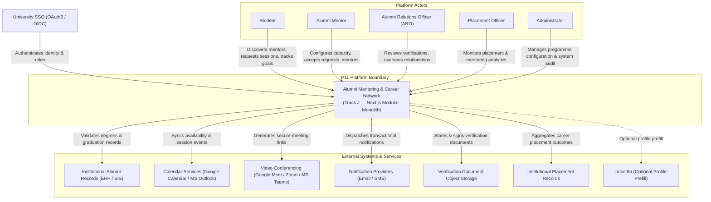

Verification documents are stored through an object-storage integration
and reviewed through the M1 verification workflow. The application does
not treat uploaded document binaries as ordinary domain records.

------------------------------------------------------------------------

# 5. Container-Level Architecture

The system is organized into the following major runtime components.

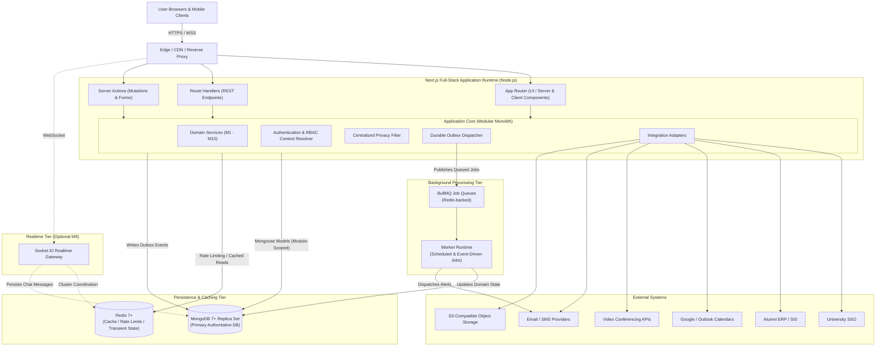

Under Track J — Path J1, the Next.js full-stack application and its
application core run on the Node.js runtime. MongoDB with Mongoose is the
durable persistence boundary.

The architecture is one logical application with separately scalable
worker capability rather than independent domain microservices. When M9
messaging is enabled, a separately deployable realtime runtime may be
added without changing the M9 domain boundary.

------------------------------------------------------------------------

# 6. Application Architecture

## 6.1 Layered Structure

Each module follows the same internal conceptual layering:

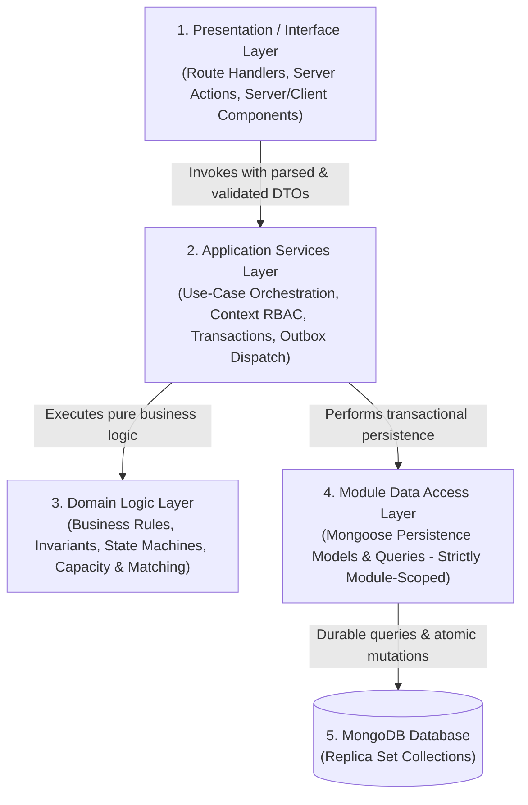

Cross-cutting infrastructure is accessed through controlled
infrastructure interfaces.

### Presentation

Responsible for:

-   HTTP/request handling;
-   authentication context extraction;
-   input parsing;
-   calling application services;
-   rendering responses.

Presentation code shall not own business rules.

### Application Services

Responsible for:

-   use-case orchestration;
-   authorization checks that depend on application context;
-   transaction/atomic-operation coordination;
-   calling domain logic;
-   invoking integration adapters.

### Domain Logic

Responsible for:

-   business rules;
-   state transitions;
-   matching logic;
-   capacity rules;
-   request rules;
-   engagement rules.

Domain logic shall not depend on Next.js request/response objects.

### Data Access

Each module owns its persistence models and data-access logic.

A module shall not directly query another module's persistence model.

------------------------------------------------------------------------

# 7. Module Architecture

## 7.1 Modules

| Module | Primary Responsibility | Major Dependencies |
| --- | --- | --- |
| M1 Alumni Verification & Profile | Verification and mentor profile | Institutional verification source |
| M2 Capacity & Availability | Mentor capacity and availability | M1 |
| M3 Student Career Profile | Student career information | None |
| M4 Matching | Discovery, ranking, and explanation | M1, M2, M3 |
| M5 Requests & Acceptance | Request lifecycle | M4, M2 |
| M6 Scheduling & Sessions | Sessions and scheduling | M5, calendar adapters |
| M7 Goals & Feedback | Goals, actions, and feedback | M6 |
| M8 Engagement | Engagement assessment and nudges | M6, M7 |
| M9 Messaging | Relationship communication when enabled | M5 |
| M10 Analytics | Programme reporting | M7, M8 |

These dependencies preserve the P11 module relationships specified in
the source brief.

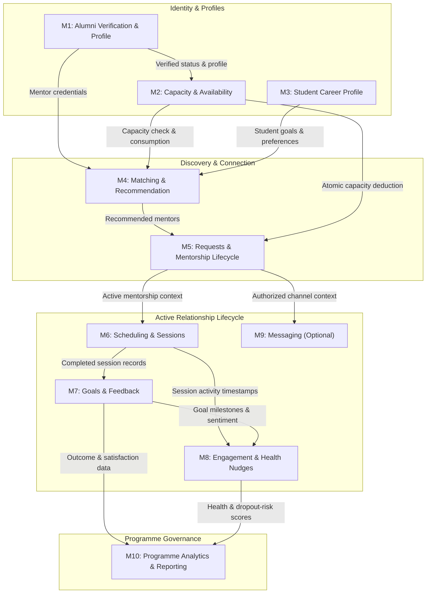

------------------------------------------------------------------------

## 7.2 Module Ownership Rule

Each module owns:

-   its business logic;
-   its domain service interfaces;
-   its persistence models;
-   its validation rules;
-   its module-specific tests.

Other modules interact through the exposed internal service interface.

------------------------------------------------------------------------

## 7.3 No Cross-Module Database Access

For example:

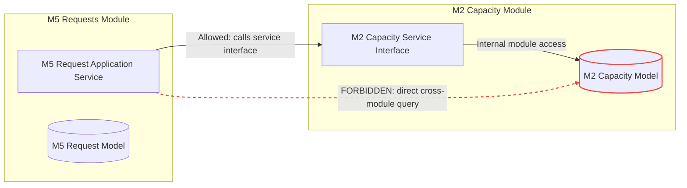

This follows the CES requirement that modules communicate through
documented internal service interfaces and not through cross-module
direct database access.

------------------------------------------------------------------------

## 7.4 Institution / Tenant Context

The system shall be multi-tenant-ready from the architectural
foundation. Every domain record shall belong to an institution context,
and application services shall preserve that context across
authentication, authorization, module calls, and data-access operations.

The HLD does not define the field type, index structure, or schema shape
for institution context; those decisions belong in the ERD and database
design.

------------------------------------------------------------------------

# 8. Request and Data Flow

## 8.1 Synchronous Request Flow

Typical interactive operation:

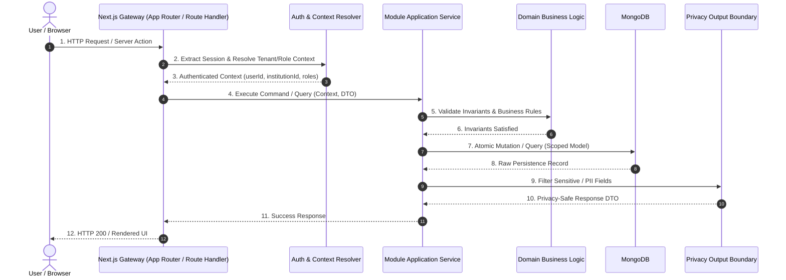

The client never becomes the owner of a business rule.

------------------------------------------------------------------------

## 8.2 Asynchronous Flow

For background work:

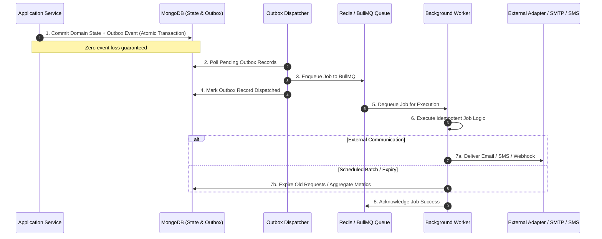

------------------------------------------------------------------------

# 9. Background Processing Architecture

P11 has several operations that should not execute as long-running
interactive requests.

## 9.1 Job Categories

### Scheduled jobs

-   request expiry;
-   weekly engagement assessment;
-   scheduled reminders;
-   recurring maintenance.

### Event-triggered background jobs

-   notification delivery;
-   external calendar synchronization where asynchronous processing is
    appropriate;
-   report generation;
-   analytics preparation.

------------------------------------------------------------------------

## 9.2 Queue Isolation

Logical job categories should be separated so that high-volume
notification work cannot starve engagement or expiry processing.

Example:

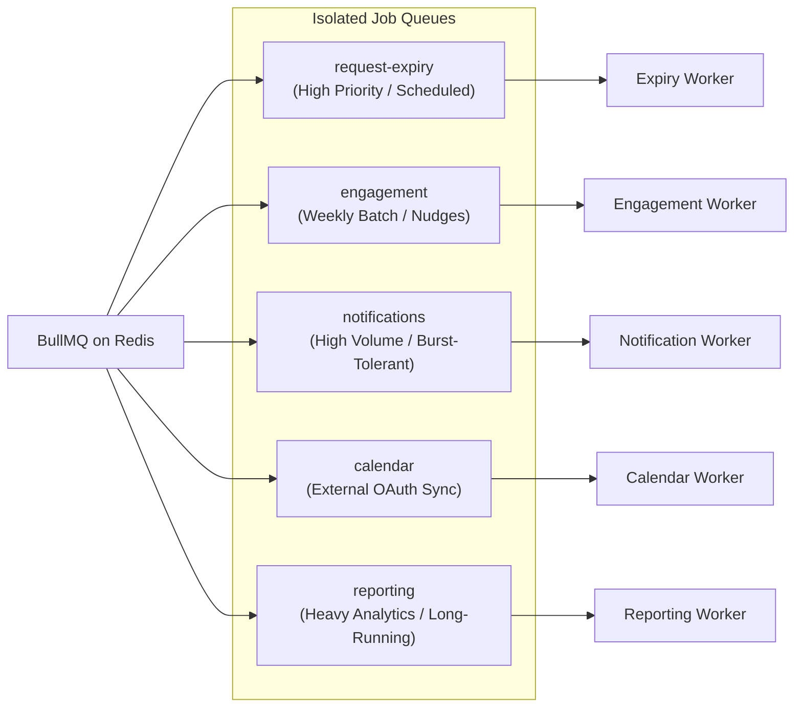

The exact queue names remain an implementation detail and may be refined
without changing the architecture.

------------------------------------------------------------------------

## 9.3 Scheduled Processing

Scheduled work shall use BullMQ repeatable jobs.

It shall not depend on:

-   in-process timers;
-   application startup;
-   page requests;
-   cron running inside the web process.

This follows the CES scheduling rule.

------------------------------------------------------------------------

# 10. Matching and Recommendation Architecture

## 10.1 Architectural Responsibility

Matching belongs inside the application/domain layer rather than in the
frontend or a separate microservice.

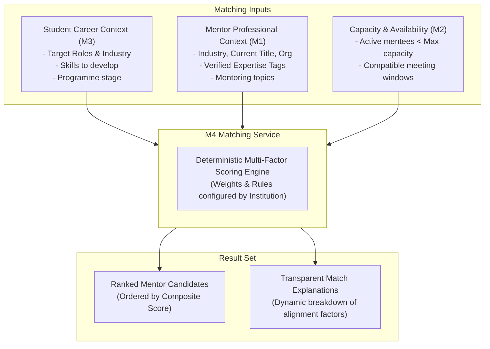

------------------------------------------------------------------------

## 10.2 Matching Flow

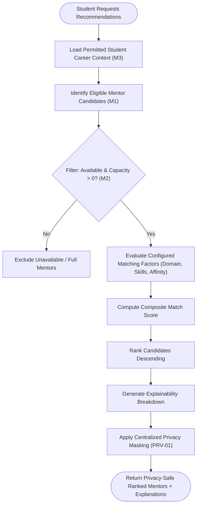

The P11 brief requires matching to be computed on demand with capacity
filtering and each match to have an explanation.

------------------------------------------------------------------------

## 10.3 Explainability Boundary

The matching service shall produce both:

1.  ranking outcome;
2.  explanation factors.

The explanation must be generated from the same matching inputs that
produced the ranking.

This ensures the explanation cannot drift from the recommendation logic.

------------------------------------------------------------------------

## 10.4 Future AI Extension

The architecture keeps matching behind an internal service boundary.

This allows a future semantic/embedding-based matcher to replace or
extend the initial deterministic approach without requiring a new public
architecture.

AI/ML remains optional for the initial release.

------------------------------------------------------------------------

# 11. Capacity and Concurrency Architecture

This is one of the most critical architecture sections in P11.

## 11.1 Invariant

``` text
Active mentees ≤ Mentor capacity
```

This condition must hold even during concurrent acceptance.

------------------------------------------------------------------------

## 11.2 Acceptance Flow and Concurrency Strategy

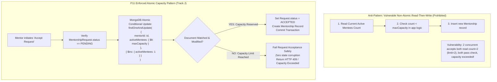

------------------------------------------------------------------------

## 11.3 Track J Strategy

The P11 specification requires Track J capacity enforcement under
concurrent acceptance through a **conditional update that fails when the
capacity has already been reached**.

Therefore the acceptance operation shall use an atomic database
operation whose condition includes the mentor's current capacity.

The architecture strictly prohibits using independent read-then-write
operations without an atomic condition.

------------------------------------------------------------------------

## 11.4 Failure Semantics

If the atomic capacity operation fails:

- No new active mentorship is created.
- The request remains in non-accepted state.
- The user receives a clear capacity-related outcome.

No later operation may assume acceptance succeeded.

## 11.5 Transaction and Idempotency Boundary

The atomic capacity-safe operation is the correctness boundary for
concurrent acceptance. Where multiple durable state changes must remain
consistent, a MongoDB transaction shall be used in the production
replica-set deployment.

Capacity is also released when an active mentorship ends. The capacity
decrement and the corresponding relationship transition to ended shall
share the same consistency boundary as the acceptance increment and
relationship creation. No independent code path may change the capacity
counter without the corresponding mentorship transition.

The acceptance design shall remain idempotent: repeating the same
acceptance operation shall return the existing outcome or fail safely; it
shall not create a second mentorship or consume capacity twice.

------------------------------------------------------------------------

# 12. Authentication and Authorization Architecture

## 12.1 Authentication Flow

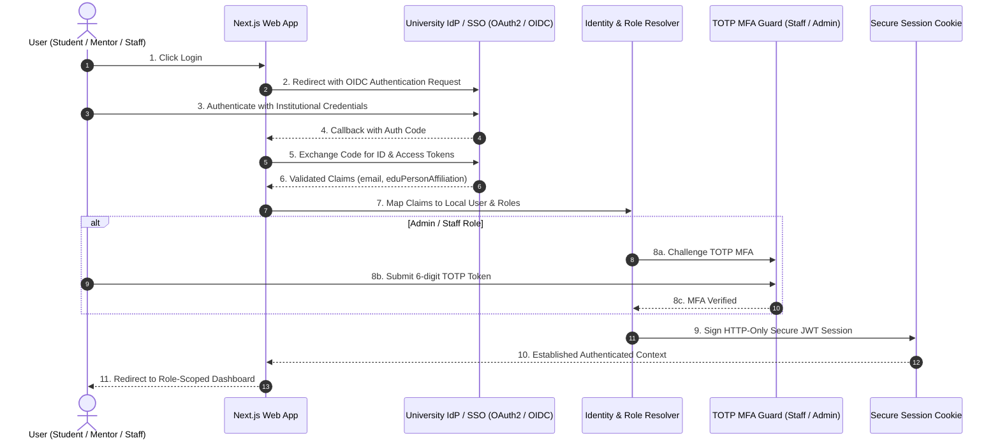

Administrative users additionally satisfy the required MFA policy.

------------------------------------------------------------------------

## 12.2 Authorization Model

Authorization uses:

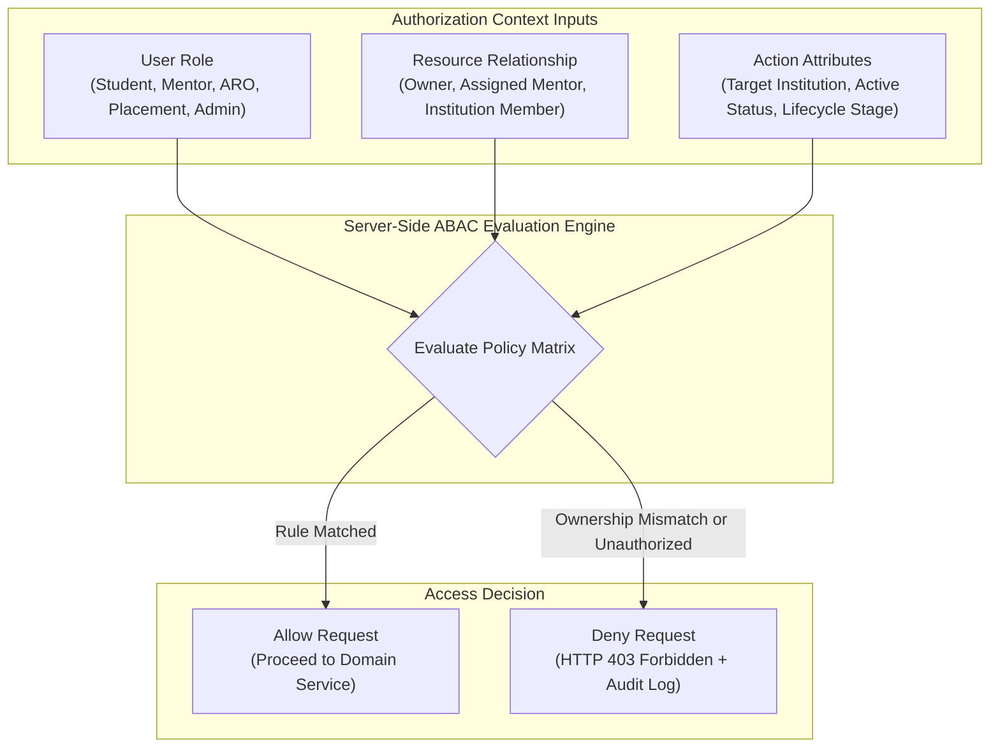

Examples:

- **Student:** Own career profile: Allow; Another student's career profile: Deny.
- **Mentor:** Own requests: Allow; Another mentor's requests: Deny.
- **Placement Officer:** Permitted placement/mentoring analytics: Allow; Mentor private management data: Deny.

------------------------------------------------------------------------

## 12.3 Server-Side Enforcement

Authorization decisions are made in the server/application layer.

UI visibility is only a presentation concern and never constitutes
authorization.

This follows the CES requirement for server-side RBAC with attribute
checks.

------------------------------------------------------------------------

# 13. Privacy and Data-Protection Architecture

## 13.1 Privacy Boundary

Private mentor contact information is treated as restricted data.

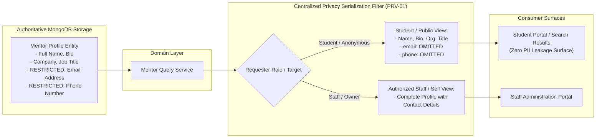

------------------------------------------------------------------------

## 13.2 Output Protection

All student-facing mentor data shall pass through a centralized
privacy-aware output boundary.

The architecture shall not rely on individual UI components remembering
which fields are private.

The P11 brief specifically identifies contact-detail masking as a Track
J serialization-layer concern.

------------------------------------------------------------------------

## 13.3 Privacy Testing Boundary

The student-facing system boundary shall be testable as a single privacy
surface so exhaustive endpoint testing can prove that prohibited fields
are absent.

------------------------------------------------------------------------

# 14. Integration Architecture

## 14.1 Adapter Pattern

External services shall be isolated behind integration interfaces.

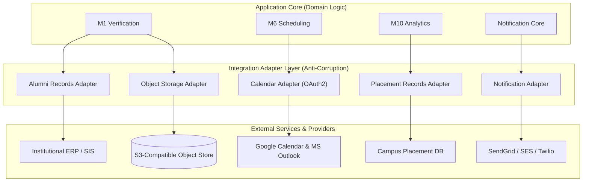

The domain layer should not contain provider-specific logic. Placement
outcomes use a separate institution-approved adapter and do not become
part of the alumni-records or mentoring-domain adapter.

------------------------------------------------------------------------

## 14.2 Alumni Verification Integration and Document Storage

P11 verification includes an institutional check and an administrative
document-review workflow. The architecture isolates document binaries in
object storage while the verification module owns review state and references.

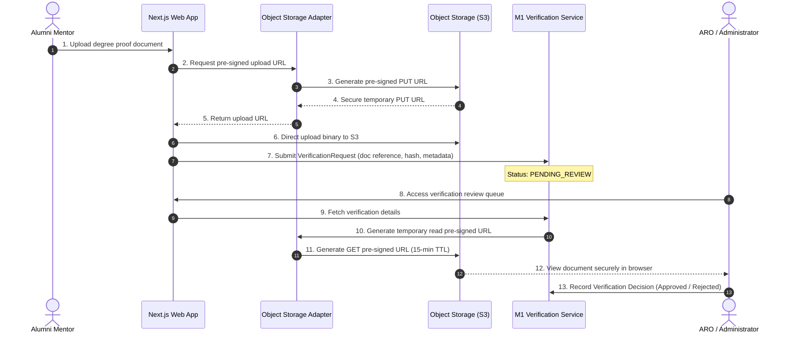

A temporary external-system failure must never be interpreted as a
successful verification.

The exact object-storage provider and policy values are deployment and
security configuration decisions. The required validation, malware
scanning, storage boundary, and signed-access controls are governed by the
SRS and must remain within this architectural boundary.

------------------------------------------------------------------------

## 14.4 Calendar Integration

Calendar integration is isolated so that:

-   Google Calendar;
-   Microsoft Outlook

can be supported without embedding provider-specific logic into the
scheduling domain.

The P11 brief requires both calendar options for Track J.

Google Calendar and Microsoft Outlook authorization shall use OAuth
through their respective integration adapters. Provider tokens remain
within the integration boundary and are not exposed to the domain or
client layers.

------------------------------------------------------------------------

## 14.5 Optional Integrations

LinkedIn remains an optional profile-prefill integration.

Its absence shall not block:

-   alumni verification;
-   mentor discovery;
-   matching;
-   mentorship;
-   sessions.

------------------------------------------------------------------------

## 14.6 Placement-Outcome Integration

Placement outcomes are obtained through an institution-approved source or
adapter. They are kept outside the mentoring domain's source-of-truth
logic and are only made available to the authorized analytics boundary.

The adapter shall distinguish unavailable source data from an actual
zero-outcome result. Placement data must remain institution-scoped and
must not be exposed directly to students or mentors.

------------------------------------------------------------------------

# 15. Notification and Messaging Architecture

## 15.1 Notification Architecture

Business event:

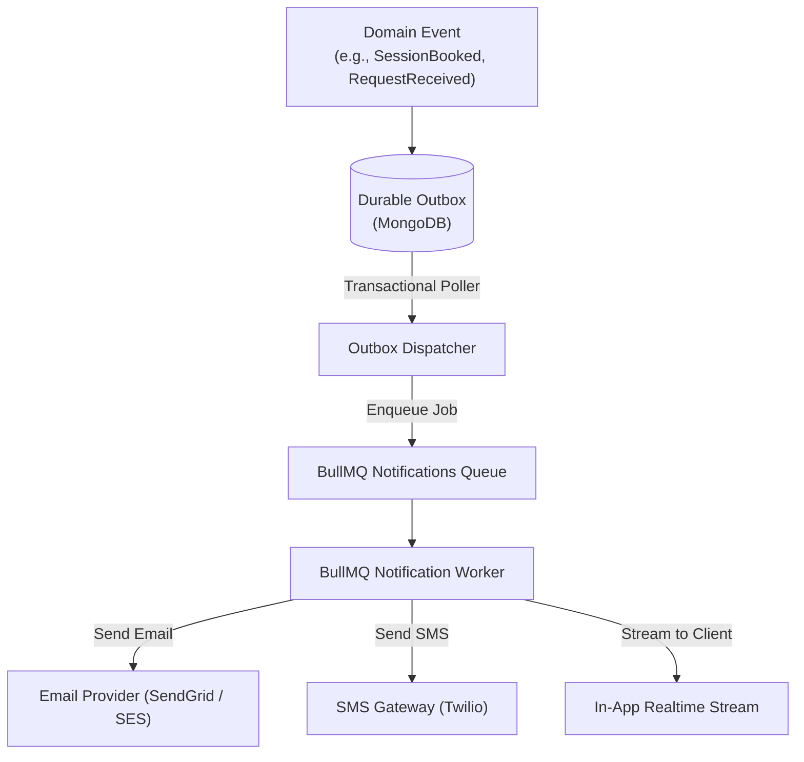

The notification mechanism shall not own the underlying business state.

Business events that require asynchronous processing shall first be
recorded in a durable outbox as part of the same transaction as the
business change. An outbox dispatcher shall publish pending events to
BullMQ and mark them as dispatched only after successful enqueueing.
Retries shall be idempotent so a notification cannot create a duplicate
business outcome.

------------------------------------------------------------------------

## 15.2 Messaging Architecture and Scale-Out Path

For enabled M9 messaging, clients connect over WebSockets to a
Socket.IO realtime layer backed by Redis for multi-instance pub/sub and
MongoDB for persistent conversation history:

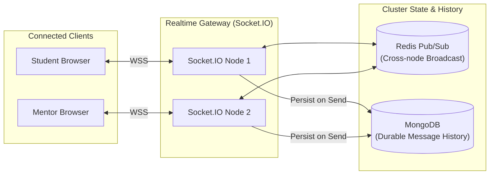

The messaging layer must still use the same relationship authorization
rules as other mentorship operations.

The Track J P11 specification identifies Socket.IO for messaging.

The logical module boundary remains unchanged.

------------------------------------------------------------------------

# 16. Caching, Rate Limiting, and State

## 16.1 Redis Responsibilities

Redis shall be used for:

-   request throttling state;
-   application caching where useful;
-   session/shared transient state where required;
-   BullMQ job coordination.

The CES explicitly assigns Redis these responsibilities in Track J.

------------------------------------------------------------------------

## 16.2 What Redis Does Not Own

Redis shall not become the authoritative store for core mentoring
records.

Core business records remain authoritative in MongoDB.

------------------------------------------------------------------------

## 16.3 Cache Strategy

Cache only data that can tolerate temporary staleness.

Examples of suitable candidates:

-   non-sensitive mentor discovery metadata;
-   relatively stable taxonomy data;
-   aggregate dashboard values with explicit freshness expectations.

Capacity and request eligibility shall not depend on stale cache state.

## 16.4 Redis Failure Semantics

If Redis is unavailable, operations that require request throttling,
distributed coordination, session state, or queue submission shall fail
closed or report temporary unavailability. The system shall not silently
allow an unthrottled request or report a queued job as accepted.

Non-critical cached reads may bypass Redis and read from the authoritative
source when safe. Core business records remain durable in MongoDB.

------------------------------------------------------------------------

# 17. Observability and Operational Architecture

The capabilities in this section are operational requirements. Specific
logging, error-monitoring, and probe tools may be replaced without
changing the domain architecture.

## 17.1 Logging

The system shall use structured JSON logging. Pino is a CES-aligned
implementation option.

Logs shall contain useful operational context while excluding prohibited
personal information.

------------------------------------------------------------------------

## 17.2 Error Monitoring

The deployment shall provide application error monitoring for exceptions
and relevant operational failures. Sentry is the current implementation
option.

Sensitive personal data shall not be attached to error events.

------------------------------------------------------------------------

## 17.3 Health Endpoints

The runtime shall expose health and readiness probes. The current route
names are:

``` text
/health
/ready
```

with separate meanings:

**health:** process is alive.

**ready:** required dependencies are available sufficiently for the
instance to serve traffic.

------------------------------------------------------------------------

## 17.4 Monitoring

Operational monitoring shall cover:

-   application availability;
-   request latency;
-   error rate;
-   worker failures;
-   queue depth;
-   failed external integrations;
-   database health;
-   Redis health.

------------------------------------------------------------------------

# 18. Security Architecture

## 18.1 Security Layers

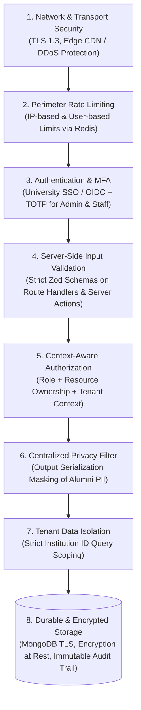

No single layer is relied upon to provide all security.

------------------------------------------------------------------------

## 18.2 Input Validation

All externally supplied inputs shall be validated server-side before
entering domain operations.

Track J uses Zod for endpoint validation under the CES.

------------------------------------------------------------------------

## 18.3 Rate Limiting

Rate limiting applies:

-   per IP;
-   per authenticated user where applicable.

This covers both security-sensitive activity and programme controls such
as mentorship-request throttling.

These are conceptually separate limits and shall not be treated as the
same rule.

------------------------------------------------------------------------

## 18.4 Sensitive Information

The architecture shall prevent personal data from appearing in:

-   logs;
-   errors;
-   analytics events;

unless explicitly required and approved.

------------------------------------------------------------------------

## 18.5 Secrets

Secrets shall come from environment/runtime configuration.

Secrets shall not be stored in source control.

The CES also requires secret scanning in CI.

------------------------------------------------------------------------

# 19. Reliability and Failure Handling

## 19.1 External Dependency Failure

External integrations may fail independently.

The architecture follows a strict circuit-breaking and error classification pattern:

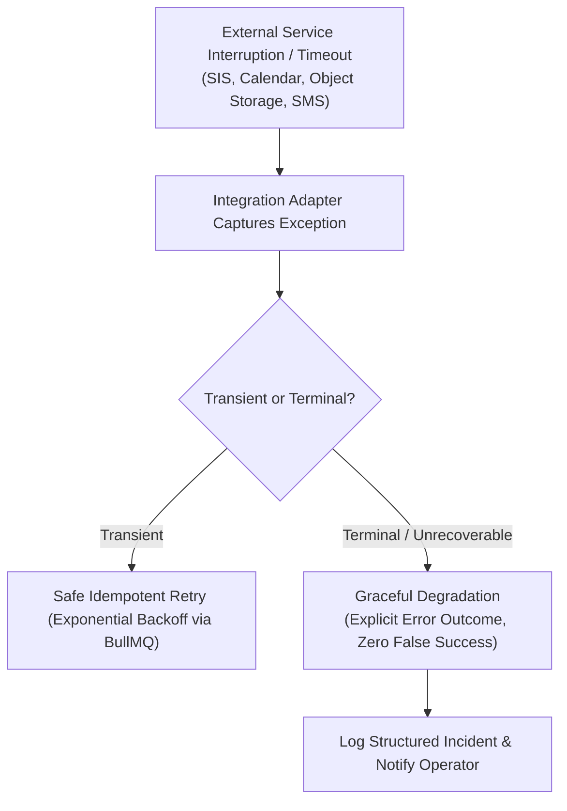

------------------------------------------------------------------------

## 19.2 Job Failure

Background jobs shall support safe retry.

Retryable work shall be designed to be idempotent so repeating the job
does not create duplicate business outcomes.

------------------------------------------------------------------------

## 19.3 Worker Restart

Scheduled and queued work shall survive application/worker restarts
because job state is managed through Redis/BullMQ rather than process
memory.

------------------------------------------------------------------------

## 19.4 Calendar Failure

If calendar synchronization fails:

-   No false "synchronized" state is assumed or reported.
-   The failure reason is durably recorded on the session entity.
-   The user receives a clear outcome with action guidance.
-   Safe retry remains possible through the scheduling integration adapter.

------------------------------------------------------------------------

## 19.5 Database Failure

If the database is unavailable:

-   requests requiring persistence shall fail safely;
-   no successful business state shall be returned without durable
    persistence;
-   readiness should prevent traffic from being routed to an instance
    that cannot operate correctly.

------------------------------------------------------------------------

# 20. Scalability and Performance Architecture

## 20.1 Scale Target

The architecture must support the CES baseline of:

-   2,000 sustained concurrent users
-   5,000 peak concurrent users

------------------------------------------------------------------------

## 20.2 Horizontal Scaling

The interactive application layer shall be designed to support multiple
instances.

Shared state that must survive between instances belongs in:

-   MongoDB;
-   Redis;
-   supported external services.

In-process memory shall not be treated as authoritative shared state.

------------------------------------------------------------------------

## 20.3 Worker Scaling

Background workers shall scale independently from request-serving
instances.

```mermaid
flowchart LR
    subgraph InboundTraffic ["User Traffic"]
        Req1["Interactive Student & Mentor Requests\n(Matching, Profiles, Session Booking)"]
        Req2["Heavy Batch Operations\n(Bulk Expiry, Analytics Reports, Mass Nudges)"]
    end

    subgraph ComputeSeparation ["Compute Isolation"]
        WebTier["Next.js Web / API Instances\n(Optimized for Low Latency: Read <400ms, Write <800ms)"]
        WorkerTier["BullMQ Worker Fleet\n(Separately Autoscaled: Long-Running Jobs)"]
    end

    Req1 --> WebTier
    Req2 -->|"Asynchronous Job Enqueue"| WorkerTier
```

------------------------------------------------------------------------

## 20.4 Latency Strategy

The architecture targets:

-   read API p95 < 400 ms;
-   write API p95 < 800 ms.

Long-running operations such as heavy reports shall move to background
processing.

------------------------------------------------------------------------

## 20.5 Search Strategy

Mentor discovery shall begin with the capabilities provided by MongoDB.

If the project's actual search requirements exceed the database's
practical capability, the architecture permits a dedicated search
capability such as MongoDB Atlas Search, consistent with CES guidance.

A second search system is not required unless justified by the actual
discovery workload.

------------------------------------------------------------------------

# 21. Deployment Architecture

## 21.1 Environments

The project maintains an automated promotion pipeline:

```mermaid
flowchart LR
    Dev["Local Dev\n(Docker Compose)"] -->|"git push"| CI["GitHub Actions CI\n(Lint, Typecheck, Test, Audit)"]
    CI -->|"Automated Deploy"| Staging["Staging Environment\n(Integration Tests & Demo)"]
    Staging -->|"Manual Approval"| Prod["Production Cloud\n(Multi-AZ Replica Set & Autoscaling)"]
```

Staging shall be used for milestone demonstrations and integration
validation.

------------------------------------------------------------------------

## 21.2 Production Logical Topology

```mermaid
flowchart TB
    Users["Platform Users\n(Students, Mentors, Staff, Admins)"] -->|"HTTPS / WSS"| Edge["Edge CDN / WAF / SSL Termination"]

    subgraph CloudVPC ["Production Cloud Environment"]
        LB["Load Balancer / Ingress Controller"]
        Edge --> LB

        subgraph WebFleet ["Next.js Application Runtime Fleet"]
            Web1["Next.js Node Instance 1"]
            Web2["Next.js Node Instance 2"]
            WebN["Next.js Node Instance N\n(Auto-Scaled)"]
        end

        LB --> WebFleet

        subgraph WorkerFleet ["Dedicated BullMQ Worker Fleet"]
            W1["Worker 1 (Expiry & Notifications)"]
            W2["Worker 2 (Reports & Analytics)"]
        end

        subgraph RealtimeGateway ["Optional Realtime Runtime (M9)"]
            RT["Socket.IO Node Cluster"]
        end
        LB -.->|"WebSocket"| RT

        subgraph ManagedData ["Managed Persistence Layer"]
            MongoCluster[("MongoDB Atlas Replica Set\n(Primary + Secondaries)")]
            RedisCluster[("Managed Redis Cluster\n(Queues, Limits, Pub/Sub)")]
        end

        WebFleet --> MongoCluster
        WebFleet --> RedisCluster
        RedisCluster --> WorkerFleet
        WorkerFleet --> MongoCluster
        RT <--> RedisCluster
        RT --> MongoCluster
    end

    subgraph ExtIntegrations ["Third-Party Integration Services"]
        ExtSSO["University SSO (OIDC)"]
        ExtSIS["University SIS"]
        ExtCal["Google / Outlook Calendars"]
        ExtEmail["SendGrid / Twilio"]
        ExtS3["Object Storage"]
    end

    WebFleet & WorkerFleet --> ExtSSO
    WebFleet & WorkerFleet --> ExtSIS
    WebFleet & WorkerFleet --> ExtCal
    WebFleet & WorkerFleet --> ExtEmail
    WebFleet & WorkerFleet --> ExtS3
```

------------------------------------------------------------------------

## 21.3 Hosting Direction

The production deployment is structured as:

-   one Next.js full-stack application runtime on Node.js for the App
    Router, Server Components, Route Handlers, and Server Actions;
-   a separately scalable worker runtime for BullMQ jobs;
-   a separately deployable Socket.IO runtime when M9 messaging is
    enabled;
-   MongoDB Atlas as the durable data store;
-   managed Redis for queues, throttling, and transient coordination;
-   an edge/CDN layer for static assets and traffic routing;
-   GitHub Actions for CI/CD.

The hosting provider may be selected from the CES-supported deployment
options, but it must support the Path J1 full-stack boundary. Route
Handlers and Server Actions remain owned by the Next.js application;
workers and the optional Socket.IO runtime are separate deployable
capabilities with explicit ownership.

------------------------------------------------------------------------

## 21.4 Containers

Docker builds shall use multi-stage builds.

Local development shall use Docker Compose so the required application
stack can be brought up with one command.

This follows the CES container requirement.

## 21.5 Availability, Backup, and Recovery

Production web instances shall run behind the edge/load-balancing layer
so an unhealthy instance can be removed from service. Worker instances
shall be independently restartable and scalable.

MongoDB backups shall be enabled for the production deployment and a
restore procedure shall be tested and documented. Redis is not the
authoritative store for core business records and may be rebuilt from
durable state; queued work shall be retried according to the job policy.

Health and readiness checks shall be used to prevent traffic from being
routed to an instance that cannot reach the dependencies required for its
assigned responsibilities.

------------------------------------------------------------------------

# 22. Configuration and Secrets

## 22.1 Environment Configuration

Deployment configuration and secrets shall be externalized through
environment variables or a managed secret store. Administrator-managed
programme policies are not environment variables: matching weights,
request policy, and engagement settings are persisted as versioned,
institution-scoped `ProgrammeConfiguration` records in MongoDB.

The configuration service loads the effective institution policy and may
cache it in Redis with explicit invalidation. Environment values provide
deployment defaults only when no institution-specific policy exists.

Examples of configuration categories include:

-   database connection;
-   Redis connection;
-   authentication configuration;
-   SSO settings;
-   calendar integration settings;
-   notification provider settings;
-   deployment defaults for matching, request, and engagement policy;
-   provider credentials and other secrets.

Exact variable names belong in the environment-variable reference
documentation.

------------------------------------------------------------------------

## 22.2 Secret Handling

Secrets shall:

-   never be committed to source control;
-   never be embedded in client bundles;
-   be supplied through the deployment environment or secret manager;
-   be scanned for accidental repository exposure.

------------------------------------------------------------------------

# 23. Architecture Decision Records

The following ADRs form the initial architectural decision set.

## ADR-01 --- Track and Delivery Path

**Decision:** Track J — Path J1 (Next.js Full-Stack).

**Reason:** Provides a Next.js full-stack architecture aligned with the
team's stated direction and the CES-supported path.

**Consequence:** The App Router, Route Handlers, and Server Actions own
the web and server-side application boundary on the Node.js runtime.

------------------------------------------------------------------------

## ADR-02 --- Modular Monolith

**Decision:** Use a modular monolith.

**Reason:** P11 is a Medium project; CES requires modularity while
discouraging unnecessary microservices.

**Consequence:** Modules must have strong internal boundaries and
service interfaces.

------------------------------------------------------------------------

## ADR-03 --- MongoDB + Mongoose

**Decision:** MongoDB 7+ with Mongoose.

**Reason:** Matches Track J and supports the required document-oriented
application model.

**Consequence:** Concurrency-sensitive operations must be deliberately
implemented using MongoDB atomic/conditional operations.

------------------------------------------------------------------------

## ADR-04 --- Redis + BullMQ

**Decision:** Redis for cache/rate-limit/shared transient state and
BullMQ for asynchronous/scheduled jobs.

**Reason:** Required by Track J CES and necessary for request throttling
and durable background processing.

------------------------------------------------------------------------

## ADR-05 --- Socket.IO Messaging

**Decision:** Socket.IO for enabled in-platform messaging.

**Reason:** Explicitly identified for P11 Track J.

**Consequence:** If realtime traffic requires independent scaling, the
realtime runtime may be separated without changing the M9 domain
boundary.

------------------------------------------------------------------------

## ADR-06 --- Centralized Privacy Filtering

**Decision:** Mentor contact privacy is enforced through a centralized
server-side output boundary.

**Reason:** P11 requires alumni email/phone to never reach students.

**Consequence:** Privacy protection is not duplicated across individual
pages.

------------------------------------------------------------------------

## ADR-07 --- Atomic Capacity Enforcement

**Decision:** Mentor acceptance uses an atomic capacity-safe database
operation.

**Reason:** P11 explicitly requires capacity protection under concurrent
acceptance.

**Consequence:** A simple read-then-write count check is prohibited for
the acceptance path.

------------------------------------------------------------------------

## ADR-08 --- Durable Outbox for Asynchronous Events

**Decision:** Persist asynchronous domain events in a durable outbox
before dispatching them to BullMQ.

**Reason:** A committed business change must not lose its notification,
analytics, calendar, or reporting work if queue submission temporarily
fails.

**Consequence:** Outbox dispatch and downstream job processing must be
idempotent and observable.

------------------------------------------------------------------------

## ADR-09 --- Path J1 Hosting Runtime

**Decision:** Track J — Path J1 (Next.js Full-Stack) is deployed as one
Next.js application serving the web and server runtime, with separately
scalable workers and an optional realtime runtime for enabled M9
messaging.

**Reason:** Path J1 requires the App Router, Route Handlers, and Server
Actions to own the web and server-side application boundary.

**Consequence:** Web, Route Handlers, and Server Actions remain within the
selected Next.js full-stack boundary; workers and the optional realtime
runtime are separate deployable capabilities.

------------------------------------------------------------------------

## ADR-10 --- Persistent Institution-Scoped Programme Configuration

**Decision:** Persist administrator-managed matching, request, and
engagement policies as versioned institution-scoped configuration in
MongoDB, with optional Redis caching.

**Reason:** Runtime administrator updates must survive process restarts,
apply to the correct institution, and remain auditable.

**Consequence:** Environment variables provide deployment defaults and
secrets only; policy changes use the configuration service and invalidate
any cached effective policy.

------------------------------------------------------------------------

# 24. Architecture Traceability

| Architecture Concern | SRS Requirement Area | Architectural Response |
| --- | --- | --- |
| Verified mentor | FR-M1 / INV-01 | Verification module and server-side eligibility |
| Mentor capacity | FR-M2 / INV-02 | Capacity module, atomic capacity-safe operation, and idempotent acceptance |
| Request throttling | FR-M5 / INV-03 | Redis-backed throttling and request service |
| Request expiry | FR-M5 / INV-04 | BullMQ scheduled processing |
| Relationship validity | FR-M5 / INV-05 | Request/mentorship domain boundary |
| Privacy | PRV-01--PRV-05 / INV-06 | Centralized privacy-aware output boundary |
| Authorization | SEC-01--SEC-05 / INV-07 | Server-side RBAC with relationship and attribute checks |
| Matching | FR-M4 | Dedicated matching module/service |
| Scheduling | FR-M6 | Scheduling module and calendar adapters |
| Goals/feedback | FR-M7 | Goals/Feedback module |
| Engagement | FR-M8 | Engagement module and weekly background job |
| Messaging | FR-M9 | Optional Messaging module and Socket.IO runtime |
| Analytics | FR-M10 | Analytics module and background reporting where required |
| Institution context | CES tenant-context requirement | Institution context preserved across services and data access |
| Verification documents | FR-M1 / EXT-01 | Object-storage adapter with pre-signed access and M1 review workflow |
| Programme configuration | FR-M4 / FR-M5 / FR-M8 | Versioned institution-scoped configuration in MongoDB with optional Redis cache |
| Placement outcomes | FR-M10 / EXT-15--EXT-17 | Institution-approved placement adapter and role-aware analytics boundary |
| Background work | CFR / NFR | BullMQ workers and durable outbox dispatch |
| Cache/rate limiting | SEC / FR-M5 | Redis with fail-closed throttling semantics |
| Scale | NFR-PERF | Horizontally scalable application and independent workers |
| Accessibility | NFR-ACC | Next.js/React UI architecture and accessibility pipeline |
| Deployment | CES | Explicit web/API, worker, and optional realtime runtimes |
| Backup/recovery | NFR-BKP | Managed database backups and tested restore procedure |

------------------------------------------------------------------------

# Architecture Summary

The resulting architecture brings together the Next.js full-stack modular monolith, MongoDB persistence, Redis caching/rate limiting, BullMQ background processing, and strict privacy/capacity enforcement:

```mermaid
flowchart TB
    subgraph Users ["Platform Users & Actors"]
        Student["Student"]
        Mentor["Alumni Mentor"]
        Staff["ARO / Placement Officer / Admin"]
    end

    subgraph AppBoundary ["Next.js Full-Stack Platform (Track J — Path J1)"]
        UI["App Router UI Layer\n(Server & Client Components)"]
        Endpoints["Application Entrypoints\n(Route Handlers & Server Actions)"]

        subgraph CrossCutting ["Cross-Cutting Infrastructure Guards"]
            AuthGuard["Authentication & Session Guard"]
            RateLimit["Redis Rate Limiter & Throttler"]
            PrivacyFilter["Centralized Privacy Filter (PRV-01)"]
            OutboxDispatcher["Durable Outbox Dispatcher"]
        end

        subgraph CoreMonolith ["Modular Monolith Application Core"]
            M1["M1: Verification & Profile"]
            M2["M2: Capacity & Availability"]
            M3["M3: Student Career Profile"]
            M4["M4: Matching Engine"]
            M5["M5: Mentorship Requests"]
            M6["M6: Scheduling & Sessions"]
            M7["M7: Goals & Feedback"]
            M8["M8: Engagement Assessment"]
            M9["M9: Realtime Messaging (Optional)"]
            M10["M10: Programme Analytics"]
        end
    end

    subgraph PersistenceAsync ["Persistence, Caching & Background Tier"]
        MongoDB[("MongoDB 7+ Replica Set\n(Primary Authoritative Store)")]
        Redis[("Redis 7+\n(Cache / Limits / Pub/Sub)")]
        BullMQ["BullMQ Distributed Queues"]
        Workers["Dedicated Background Workers"]
    end

    subgraph ExternalServices ["External Systems via Adapters"]
        SSO["University SSO (OIDC)"]
        SIS["Institutional Records (SIS/ERP)"]
        Cal["Google & Outlook Calendars"]
        Video["Video Conferencing APIs"]
        Mail["Email & SMS Gateways"]
        S3["Object Storage (Degree Proofs)"]
    end

    Users --> UI
    UI --> Endpoints
    Endpoints --> RateLimit --> AuthGuard --> CoreMonolith
    CoreMonolith --> PrivacyFilter --> Endpoints

    SSO --> AuthGuard
    CoreMonolith -->|"Mongoose Scoped Models"| MongoDB
    CoreMonolith -->|"Outbox Events (Transactional)"| MongoDB
    OutboxDispatcher -->|"Poll Pending"| MongoDB
    OutboxDispatcher -->|"Enqueue"| BullMQ
    BullMQ --> Redis
    BullMQ --> Workers
    Workers -->|"Update Domain Records"| MongoDB
    Workers -->|"Send Alerts"| Mail

    CoreMonolith --> SIS
    CoreMonolith --> Cal
    CoreMonolith --> Video
    CoreMonolith --> S3
```

This architecture keeps P11 as a **single logical modular product**,
while giving the system separate scaling and processing paths for
interactive requests and background jobs. When M9 messaging is enabled,
the realtime runtime can scale independently. Durable outbox dispatch
connects committed business changes to asynchronous work.

The architecture directly addresses the two most important correctness
properties in P11: **mentor capacity protection under concurrency** and
**absolute protection of alumni contact information**.
